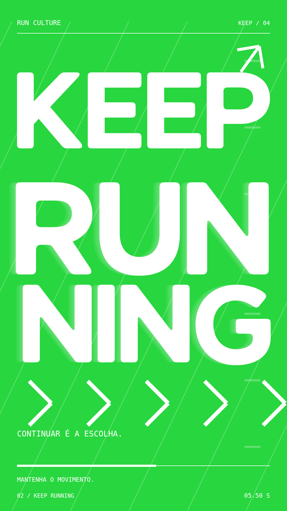

# Pulso / Running motions

## Atual: Never give up. → Nunca desista.

[HTML editável](motions/never-give-up/index.html) · [WebM transparente 1920 × 1080](assets/never-give-up-transparent.webm) · [WebM transparente 9:16](assets/never-give-up-transparent-9x16.webm) · [Pacote pronto para abrir](assets/never-give-up-package.zip)

Motion de 10 segundos com transição entre **Asset 5.svg** e **Asset 6.svg**. Os dois arquivos fornecidos já contêm contornos; não há substituição de fontes ou redesenho. 12 contornos de "Never give up." em #30d949 passam para 13 contornos de "Nunca desista." em #e5e1cf. Entradas em sequência por letra, impulsos de cadência, mudanças rápidas de inclinação, deslocamentos e zoom reforçam a estética esportiva. A troca ocorre na região dos 5 segundos, com repouso final para leitura.

Somente os elementos fornecidos são animados. Sem fundo, ilustrações adicionais, grafismos, marcas-d'água ou áudio. O quadriculado do visualizador não é exportado. As posições relativas e a escala natural de cada desenho são mantidas nos quadros de repouso; ambos foram comparados em RGBA ao respectivo original no mesmo enquadramento. Cópias estáticas dos mesmos contornos evitam diferenças de antialiasing causadas por grupos animados e garantem esses quadros exatos; apenas uma representação de cada vetor fica visível por vez.

SVG animado em [motions/never-give-up/motion.svg](motions/never-give-up/motion.svg). Fontes em `vector-1.svg`, `vector-2.svg` e `build.py`; os SVGs originais permanecem intactos. Gere o HTML e SVG com `python motions/never-give-up/build.py` (FontTools necessário apenas para esse passo de desenvolvimento). O HTML inclui tudo o que precisa para reprodução local, sem fontes externas ou chamadas de rede. [Relatório de validação](tests/PHRASE_MOTION_REPORT.md).

## Logo original GET → KEEP, transparente

[Visualizador HTML](motions/logo-get-keep/index.html) · [WebM transparente horizontal](assets/get-keep-logo-transparent.webm) · [WebM transparente 9:16](assets/get-keep-logo-transparent-9x16.webm) · [SVG animado](motions/logo-get-keep/logo-animated.svg) · [Pacote pronto para abrir](assets/get-keep-logo-package.zip)

Animação direta da logo fornecida em SVG, sem fundo, imagens, faixas, textos adicionais ou marca-d'água na animação. 10 segundos, 30 fps; GET sai e KEEP entra na região dos 5 segundos. Entradas e impulsos de ritmo usam somente os contornos da logo. Todos os 15 contornos originais e suas cores foram preservados. O quadro de repouso de GET foi comparado ao SVG original em todos os canais RGBA, pixel por pixel, sem diferença.

O arquivo recebido inclui letras verdes e brancas, inclusive GET e duas construções brancas de N. Elas são mantidas. KEEP não estava no arquivo e foi desenhado separadamente com altura, espessura e arredondamento compatíveis com GET; não se afirma que KEEP foi fornecido pelo usuário. O fundo quadriculado/escuro/claro existe apenas no visualizador para inspecionar a transparência; não é exportado. O RUNNING permanece na mesma posição durante a troca de palavra.

Formato horizontal: 1518 × 1010. Formato vertical: 1080 × 1920 com a mesma logo proporcionalmente centralizada e margens transparentes. WebM VP9 inclui alpha real, verificado após decodificação com libvpx. MP4 convencional não é oferecido nesta versão, pois não mantém a transparência. Compatibilidade de WebM com alpha varia conforme navegador/editor; SVG e HTML permitem inspeção vetorial independente do vídeo.

Fontes em `motions/logo-get-keep/`: original.svg intacto, keep.svg editável, build.py, logo-animated.svg, keep-running.svg e index.html autossuficiente. Execute `python motions/logo-get-keep/build.py` após editar os contornos ou o roteiro de animação. [Relatório](tests/LOGO_MOTION_REPORT.md).

## GET → KEEP / estudo anterior de composição

[HTML editável](motions/get-keep/index.html) · [MP4 1080 × 1920](assets/get-keep-running.mp4)

Animação de impacto, 10 segundos, 9:16, baseada no asset enviado pelo usuário. Lettering verde arredondado reconstruído manualmente em contornos vetoriais. Aos 5 segundos, GET sai e KEEP entra, mantendo RUNNING. Linhas de pista, rastros, zoom em detalhes, cortes de cor e chevrons reforçam a aceleração. Sem áudio. A palavra KEEP usa desenhos compatíveis com a referência; não se afirma extração exata do asset original.

`motions/get-keep/index.html` é autossuficiente e funciona sem dependências de rede. Inclui pausa, repetição, linha do tempo e respeito a movimento reduzido. Fonte da interface depende do sistema; lettering principal usa os mesmos caminhos vetoriais em qualquer computador.

Fontes editáveis: `motions/get-keep/source.js` (animação), `lettering.json` (contornos) e `build.py` (gera HTML independente e prova SVG). Depois de editar JS ou JSON, execute `python motions/get-keep/build.py`. A prova SVG está em `motions/get-keep/lettering-proof.svg`. A referência visual fornecida pelo usuário mantém os direitos de seu titular; a licença MIT do código não altera esses direitos.

[Relatório de teste do novo motion](tests/GET_KEEP_REPORT.md).

## Run culture / versão anterior

Filme vertical de tipografia cinética sobre cultura running: **10 segundos, proporção 9:16**. Cinco cenas combinam palavras em movimento e ilustrações vetoriais originais: corredores articulados, tênis, cidade e percurso animado.

| Tempo | Conteúdo |
| --- | --- |
| 0–2,1 s | Dê o primeiro passo — corredor, linhas de velocidade e cidade. |
| 2,1–4,2 s | Encontre seu ritmo — tênis ilustrado, órbitas e cadência. |
| 4,2–6,2 s | Ninguém corre só — grupo de corredores e ecos tipográficos. |
| 6,2–8 s | A rua é nossa — mapa de bairro e percurso em movimento. |
| 8–10 s | Corra. Respire. Repita. — grupo, chamada final e assinatura Pulso. |

## Abrir

Abra `index.html` no navegador. Tudo está incorporado no arquivo: CSS, JavaScript e desenho vetorial em Canvas. Não exige instalação, compilação, servidor, conexão ou dependências. Usa a fonte sem serifa do sistema; nenhuma fonte, fotografia ou música de terceiros é distribuída. As imagens são ilustrações, não fotografias. Sem áudio.

**Reproduzir** inicia ou pausa; **Repetir** ativa o ciclo; a linha do tempo permite examinar qualquer quadro. A animação começa automaticamente, exceto quando o sistema solicita movimento reduzido: mostra o quadro final e aguarda ação do usuário. A proporção vertical é preservada em telas pequenas e grandes.

## Arquivos

- `assets/pulso-running.mp4`: versão nova, H.264, 1080 × 1920, 30 fps, 10 segundos.
- `assets/running-preview.png`: quadro de prévia.
- `assets/scene-1.png` a `scene-5.png`: quadros de cada cena.
- `demo-4s.html` e `assets/pulso-demo.mp4`: primeira demonstração horizontal, preservada.
- `tests/REPORT.md`: testes executados e limitações.

## Desenvolvimento e créditos

Edite o HTML. Para servir opcionalmente: `python -m http.server 8080`. `window.Pulso.seek(milissegundos)` posiciona a animação determinística para captura. O desenho original de cada cena usa caminhos vetoriais, geometria, articulações e curvas; não há imagens externas carregadas durante a execução.

Criação assistida por Codex para acentinocreate. Licença MIT. Chromium/Playwright/FFmpeg são ferramentas de verificação/renderização, não dependências distribuídas no aplicativo. A fonte do sistema pode produzir diferenças de aparência em outros computadores.

Compatibilidade pretendida: versões atuais de Chrome, Edge, Firefox e Safari com Canvas 2D. Testes realmente executados estão no relatório. Repositório: https://github.com/acentinocreate/pulse. O usuário criou o repositório pela interface do GitHub; a publicação usa a conexão Git existente, sem depender da API de criação.
